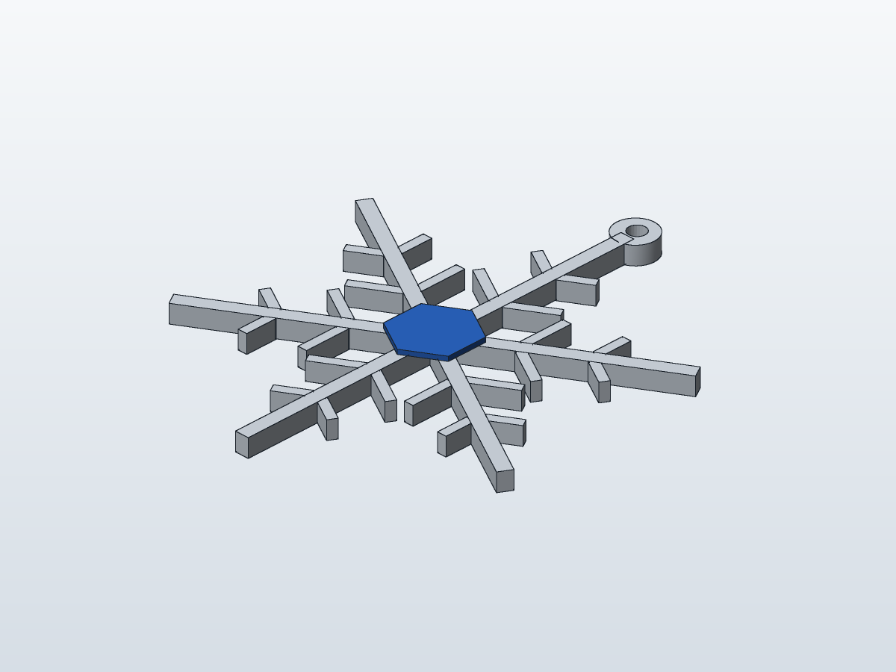

# Frost Crystal Ornament (2026-11-08)

Original six-fold crystal ornament, flat-printed, two colours. The design is generic: it copies no real item, brand, character or licensed IP.

## Files
- `frost-crystal-ornament.3mf`: print file, mm units, two named/coloured parts (`Crystal Body`, `Hub Inlay`)
- `frost-crystal-ornament.kerf.json`: editable Kerf CAD source (open in the Kerf web app)
- `preview.png`: render

## Why this one (trend notes)
Sources checked today were blog guides and Etsy listing pages, not hard sales data, so treat them as directional only:
- November is the lead-in to holiday gifting; ornaments and stocking stuffers are listed as steady seasonal sellers.
- Articulated animals are reported as the top category but also as saturated with collapsing prices. I avoided that crowded niche.
- Personalised and gift items reportedly hold price better. This ornament has a ribbon loop and a flat blue hex inlay that can be swapped for a name or year.
- Etsy's Bestseller badge and review counts are not sales figures. Check Etsy Trending and your own search stats before pricing.

## Geometry
- 63.6 x 77.0 x 4.0 mm, about 3.2 g (PLA estimate), sits flat on the bed at Z=0
- No supports, no overhangs, no bridges
- Thickness 3.2 mm body (16 layers at 0.2 mm) plus 0.8 mm inlay (4 layers)
- Arms 2.4 mm wide (6 lines of 0.4 mm), branches 1.6 mm wide (4 lines), ribbon-loop wall at least 1.7 mm, hole 3.0 mm
- Gaps between neighbouring branches are over 1.5 mm

## Snapmaker U1 settings (0.4 mm nozzle)
- Nozzle 0.4 mm, layer height 0.20 mm, 4 walls (so 1.6 mm branches fill solid), 100% infill for these thin features, top and bottom 4 layers
- Orientation: as exported, flat. Assign `Crystal Body` to one tool head (white or silver) and `Hub Inlay` to another (blue or gold)
- Colour change happens only at layer 17 (Z=3.2), so a prime tower is small. Disable it if the inlay is printed alone.
- Brim not needed. Print time is under about 40 min.
- Re-slice in your slicer before selling. The 3MF carries geometry and colours only, not slicer settings. I have not verified these settings on a physical U1.

## Etsy listing draft (NOT published; needs your approval)
Title: Snowflake Christmas Ornament, 3D Printed Two-Tone Crystal, Tree Decoration, Stocking Stuffer Gift
Tags: christmas ornament, snowflake decor, 3d printed gift, tree decoration, stocking stuffer, winter decor, holiday gift, secret santa, hanging ornament, minimalist christmas
Description: Hand-finished 3D printed snowflake ornament, about 6.4 x 7.7 cm. Two-colour design, ribbon included. Lightweight PLA, flat and sturdy.
Pricing idea: about 6 to 9 USD single, 3-pack about 16 to 20 USD. Compare against live Etsy comps first.
